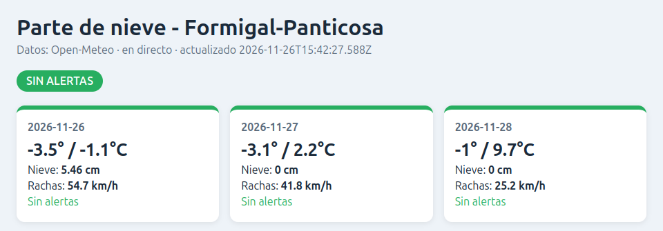

# Parte de nieve automático con n8n (Formigal-Panticosa)




Proyecto de **automatización con n8n + API REST + Docker**: genera cada día un parte de nieve con alertas operativas para una estación de esquí.

## Qué hace
1. Se dispara **cada día a las 07:30** (Schedule Trigger) o **bajo demanda** por webhook.
2. Consulta la **API pública Open-Meteo** (sin clave): temperaturas, nieve y rachas de viento a 3 días.
3. Un nodo **Code (JavaScript)** genera el parte con **alertas**:
   - Nevada fuerte: >= 10 cm
   - Viento fuerte (posible cierre de remontes): rachas >= 70 km/h
   - Frío intenso: <= -10 °C
4. **Siempre devuelve datos**: si la API falla (3 reintentos), muestra el **último dato real guardado** e indica su origen y fecha.
5. Dos salidas:
   - `GET /webhook/parte-nieve` → **JSON** (para integrarlo con otros sistemas).
   - `GET /webhook/parte-nieve-web` → **página web** con el parte (la de la imagen).

## Ejecutarlo
```bash
docker compose up -d        # n8n en http://localhost:5678
```
1. Crea el usuario local de n8n.
2. Menú ... → *Import from file* → `workflow_parte_nieve.json`.
3. Pulsa *Execute workflow* para probar y, si quieres usar los webhooks, activa el flujo (*Active*).
4. Abre http://localhost:5678/webhook/parte-nieve-web

> Si al importar n8n sustituye el *Path* de un webhook por un código, copia la *Production URL* que muestra el propio nodo (o vuelve a escribir `parte-nieve` / `parte-nieve-web`) y publica de nuevo.

## Control de calidad de datos
Antes de usar la respuesta de la API se valida: series completas, misma longitud y valores plausibles (p. ej. temperatura entre -50 y 45 °C). Si algo no cuadra, el flujo no lo usa y recurre al último dato válido, indicándolo en la página.

## Nota sobre la memoria
El último dato se guarda en el *static data* del flujo, que n8n solo persiste cuando el flujo está **activo** (ejecuciones de producción, no las de prueba manual).

## Tests
La lógica de las alertas (incluidos los valores límite) tiene tests automáticos, sin dependencias:
```bash
node --test
```
Se ejecutan también en **GitHub Actions** en cada push (`.github/workflows/test.yml`), que además comprueba que el workflow exportado está sincronizado con el código de `src/`.

## Estructura
```
src/generar_parte.js    lógica de alertas (nodo Code)
src/generar_html.js     página web del parte (nodo Code)
tests/parte.test.js     tests (node:test)
build_workflow.js       genera workflow_parte_nieve.json desde src/
workflow_parte_nieve.json   flujo para importar en n8n
docker-compose.yml      n8n en local
```
Si cambias el código de `src/`, regenera el flujo con `node build_workflow.js` y vuelve a importarlo.

## Ampliaciones posibles
- Enviar la alerta por **Telegram o correo** al responsable de operaciones.
- Nodo de **IA (LLM)** que redacte el parte en lenguaje natural.
- Guardar el histórico en **PostgreSQL/MySQL**.
- Umbrales y coordenadas configurables por variables de entorno.

## Stack
n8n · Docker / Docker Compose · API REST (Open-Meteo) · JavaScript · GitHub Actions
